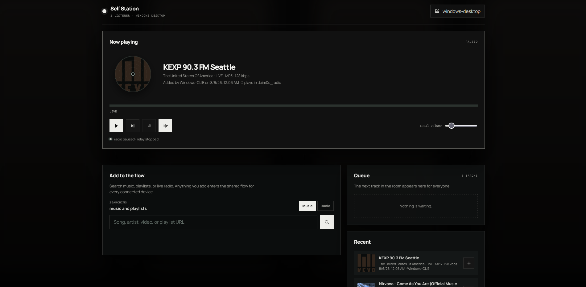

# Self Station

Self Station is a self-hosted collaborative jukebox for a home server, LAN, studio, hackerspace, or small community room. It provides shared music playback, live radio discovery, and a server-side radio relay through a compact Python service.

<p align="center">
  
</p>

## Features

- Shared queue with server-synchronized playback state.
- YouTube search, queueing, playlist preview, and playlist import through `yt-dlp`.
- Live radio search through the public Radio Browser catalog.
- One FFmpeg relay process for the currently playing live radio station.
- Local play history, play counts, and active browser devices stored in SQLite.
- Optional lyrics lookup through LRCLIB for music tracks.
- Queue removal and reordering, plus automatic radio mode.
- Docker Compose deployment with a read-only container filesystem, dropped capabilities, and a healthcheck.

## Quick start

Requirements:

- Docker and Docker Compose; or Python 3.11+, FFmpeg, and Node.js for direct execution.

```bash
git clone https://github.com/lucasnc/self-station.git
cd self-station
docker compose up -d --build
```

Open `http://localhost:8090` after the container starts. Browsers need one initial click on the audio enable button because modern browsers block autoplay until the user interacts with the page.

## Local development

```bash
python -m venv .venv
. .venv/bin/activate
pip install --pre -r requirements.txt
python server.py
```

On Windows PowerShell:

```powershell
python -m venv .venv
.\.venv\Scripts\Activate.ps1
pip install --pre -r requirements.txt
python server.py
```

## Configuration

The service is configured with environment variables. The Compose file provides production-friendly defaults.

| Variable | Default | Description |
| --- | ---: | --- |
| `SELF_STATION_HOST` | `0.0.0.0` | Bind address. |
| `SELF_STATION_PORT` | `8090` | HTTP port. |
| `SELF_STATION_DB` | `./self_station.db` | SQLite database path. |
| `SELF_STATION_SEARCH_LIMIT` | `12` | Maximum YouTube search results, capped at 25. |
| `SELF_STATION_PLAYLIST_IMPORT_LIMIT` | `100` | Maximum playlist items imported per job. |
| `SELF_STATION_BROWSER_URL` | `https://all.api.radio-browser.info` | Radio Browser API base URL. |
| `SELF_STATION_LIVE_SEARCH_LIMIT` | `24` | Maximum live radio search results. |
| `SELF_STATION_RELAY_BITRATE` | `128` | Live radio relay bitrate in kbps. |
| `SELF_STATION_FORCE_IPV4` | `1` | Prefer IPv4 DNS resolution. |
| `SELF_STATION_NODE_PATH` | auto-detected | Node.js binary used by `yt-dlp`. |
| `SELF_STATION_LYRICS_URL` | `https://lrclib.net` | Lyrics service base URL. |
| `SELF_STATION_STREAM_RESOLVE_WAIT_SECONDS` | `30` | Timeout for stream URL resolution. |

## API surface

- `GET /api/health`
- `GET /api/state`
- `GET /api/search?q=...`
- `GET /api/radio/search?q=...`
- `GET /api/lyrics?title=...&artist=...`
- `GET /api/playlist/preview?url=...`
- `GET /api/playlist/import/{job_id}`
- `GET /stream/{video_id}`
- `GET /relay/radio/{queue_id}`
- `POST /api/queue`
- `POST /api/radio/queue`
- `POST /api/queue/remove`
- `POST /api/queue/move`
- `POST /api/playlist/import`
- `POST /api/control`
- `POST /api/settings`
- `POST /api/ended`

## Deployment

The default Compose deployment persists SQLite data in `/srv/data/self-station`. See [docs/deployment.md](docs/deployment.md) for reverse-proxy and backup guidance.

## Legal notes

Self Station does not host or ship third-party media. You are responsible for how you use external services and media sources in your jurisdiction and environment.

YouTube access is provided through `yt-dlp`, live radio discovery uses Radio Browser, and lyrics are provided by LRCLIB. Their availability and behavior may change independently of this project.

## License

MIT. See [LICENSE](LICENSE).
